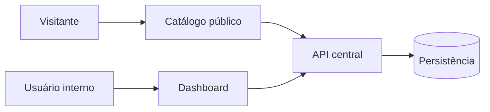

# Aplicações

**Etapa:** 06 — Aplicações  
**Estado:** Aprovada  
**Referências:** [Produto](../product/overview.md) · [Requisitos](../product/requirements.md) · [Modelo de domínio](../product/domain-model.md)

## Visão geral

A primeira entrega será composta por três aplicações publicáveis independentemente:

| Aplicação | Endereço | Responsabilidade principal |
| --- | --- | --- |
| Catálogo | `parceiros.flexclube.org` | Experiência pública, indexável e prioritariamente móvel |
| Dashboard | `painel.flexclube.org` | Operação interna autenticada |
| API | `api.flexclube.org` | Fonte central de regras, dados e contratos |

Esta separação responde às necessidades distintas de SEO e renderização do catálogo, simplicidade da interface interna e centralização das regras. Ela não implica serviços de domínio independentes nem bancos separados.

## Princípios de responsabilidade

- Regras de negócio são aplicadas centralmente pela API.
- Catálogo e dashboard não implementam versões próprias das regras centrais.
- A API é a única aplicação com acesso à persistência do produto.
- O catálogo expõe somente capacidades públicas.
- O dashboard apresenta somente capacidades autorizadas para o usuário autenticado.
- Cada frontend pode ser implantado sem exigir a implantação simultânea do outro.
- A API pode futuramente atender outro consumidor, mas não serão antecipados contratos de aplicativo móvel nesta entrega.

## Aplicações

- [Catálogo — módulos](catalog/modules.md)
- [Dashboard — módulos](dashboard/modules.md)
- [API — módulos](api/modules.md)

## Dependências

O diagrama representa dependências conceituais. Tecnologias, protocolo, topologia e persistência estão detalhados nas arquiteturas de cada aplicação e nos ADRs.

## Decisões confirmadas

- O catálogo precisa ser indexável e utilizar renderização no servidor para as páginas públicas relevantes.
- Cada parceiro possui uma URL pública estável e compartilhável.
- Alterar o nome do parceiro não altera automaticamente sua URL pública.
- Quando o identificador público for alterado explicitamente, a URL anterior redireciona permanentemente para a nova.
- O dashboard não precisa ser indexado e pode operar como SPA.
- As três aplicações utilizam subdomínios separados.
- As três aplicações podem ser publicadas independentemente.
- Astro com SSR e adaptador Node foi aprovado para o catálogo na etapa arquitetural.

## Referências técnicas

- [Arquitetura do catálogo](catalog/architecture.md)
- [Arquitetura do dashboard](dashboard/architecture.md)
- [Arquitetura da API](api/architecture.md)
- [Contratos HTTP](api/contracts/README.md)
