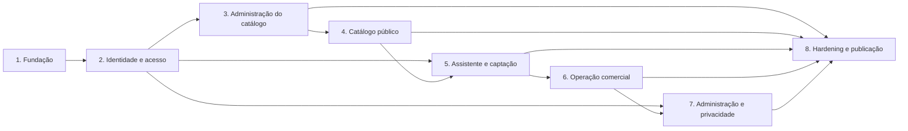

# Plano de implementação

**Etapa:** 11 — Implementação  
**Estado:** Aprovado

Este documento organiza a futura implementação. Ele não autoriza o início do desenvolvimento, que depende de autorização explícita após a revisão das especificações.

## Princípios de entrega

- Cada incremento termina integrado, testável e coerente com os contratos aprovados.
- Não haverá uma fase final dedicada a conectar partes desenvolvidas isoladamente.
- Infraestrutura e abstrações são criadas quando o incremento consumidor precisar delas.
- Migrações, contratos e testes acompanham a funcionalidade correspondente.
- Nenhum incremento amplia o escopo funcional sem nova aprovação.

## Incremento 1 — Fundação

### Objetivo

Estabelecer a base executável comum sem implementar fluxos completos de negócio.

### Entregas

- monorepo com pnpm workspaces;
- aplicações API, dashboard e catálogo inicializáveis;
- pacote de contratos compartilhados;
- TypeScript, formatação e lint;
- PostgreSQL local descartável;
- Drizzle e primeira migration;
- composição inicial da API Express;
- Pino, `requestId` e tratamento global de erros;
- endpoints de processo ativo e prontidão;
- pipeline inicial do GitHub Actions;
- builds Docker reproduzíveis.

### Critério de saída

As três aplicações compilam, a API conecta ao banco migrado, os checks obrigatórios iniciais passam e nenhum dado funcional fictício é necessário.

### Registro de execução

Executado em 2026-10-10. Decisões tomadas durante a execução, dentro do escopo aprovado:

- **Migration inicial:** `0000_baseline` não cria tabelas; estabelece o histórico versionado. As tabelas de domínio nascem nos incrementos que as consomem.
- **Dependências adiadas até o consumidor real:** TanStack Router/Query, React Hook Form, Axios e a integração React do Astro entram nos incrementos 2 e 4; Tailwind entra no dashboard no incremento 2 e no catálogo no incremento 4. Os tokens de marca ainda não existiam nas especificações; passaram a vir do `tailwind.css` (ver incremento 2).
- **TypeScript 6:** typescript-eslint e `astro check` ainda não suportam o TypeScript 7.
- **Contratos:** `@flex/contracts` é consumido como TypeScript e embutido no bundle da API.
- **Health checks:** `/v1/health/live` e `/v1/health/ready` na API; `/health` no catálogo e no dashboard (ver contratos).
- **Dashboard em container:** arquivos estáticos servidos por nginx.
- **Não coberto:** E2E, OpenAPI gerado e deploy automático dependem de fluxos e incrementos posteriores; o pipeline do GitHub Actions ainda não foi executado, pois o repositório não está versionado.

## Incremento 2 — Identidade e acesso

### Objetivo

Permitir o primeiro acesso seguro e estabelecer a autorização usada pelos incrementos seguintes.

### Entregas

- usuários, credenciais, sessões, códigos e permissões;
- comando de bootstrap do primeiro administrador;
- login, logout, ativação, recuperação e alteração de senha;
- middlewares de sessão, autenticação, CSRF e permissões;
- catálogo fixo de permissões;
- shell autenticado e telas de acesso do dashboard;
- testes de integração de autenticação, sessão e autorização.

### Bootstrap inicial

- executado somente por terminal local ou console do container;
- recebe nome completo e e-mail opcional;
- cria o primeiro usuário ativo com todas as permissões existentes;
- emite código de ativação pelas mesmas regras das demais contas;
- nunca recebe nem define a senha;
- recusa execução quando já existir qualquer usuário;
- registra auditoria com ator técnico `system/bootstrap`.

### Critério de saída

O primeiro administrador consegue ativar a conta, autenticar-se e acessar somente operações permitidas. Sessão, CSRF e revogação estão cobertos por integração.

### Registro de execução

Executado em 2026-10-10. Decisões tomadas durante a execução, dentro do escopo aprovado e detalhadas nos [contratos](../apps/api/contracts/README.md):

- **Argon2id sem dependência nova:** usa `crypto.argon2` do Node 24. O hash guarda seus parâmetros (PHC), de modo que uma recalibração na VPS não invalida senhas existentes. Os parâmetros vêm do ambiente, com o mínimo da OWASP como padrão.
- **Senhas comuns:** a recusa usa uma lista curta embutida e a detecção de padrões repetidos. A verificação contra bases de vazamentos exige serviço externo e não foi implementada.
- **E-mail:** a API chama diretamente a API HTTP do Resend por `fetch`, sem SDK. Sem `RESEND_API_KEY`, toda entrega cai no fluxo manual previsto (código exibido uma única vez).
- **Token CSRF:** derivado da sessão (HMAC do identificador, sem novo armazenamento) e entregue no cabeçalho `X-CSRF-Token` da consulta da sessão, preservando o corpo contratado.
- **Limitação de tentativas:** limitador progressivo em memória, adequado a uma única instância da API.
- **Estilos do dashboard:** Tailwind CSS 4 com os tokens do `index.css` do responsável, hoje em `apps/dashboard/src/styles/tailwind.css` (paleta laranja/navy e Geist, substituindo a paleta verde proposta). Os protótipos foram realinhados aos tokens e passam a ser a fonte de construção da UI.
- **Metadata de rota:** o título do documento é declarado no `head` de cada rota (`HeadContent` na raiz), sem `useEffect`.
- **Auditoria:** a tabela de eventos nasce aqui para registrar o bootstrap (`user.created`, `user.permissions.updated`, `user.access-code.issued`); imutabilidade reforçada no banco, consulta e filtros ficam para o incremento 7.
- **Catálogo de permissões:** identificadores definidos em `packages/contracts` (ver contratos).
- **Navegação do dashboard:** somente o grupo Conta existe; os demais grupos entram com seus módulos.

Pendências conhecidas, sem bloqueio para os próximos incrementos:

- **Troca de senha obrigatória após redefinição administrativa (`CA-RF-015-11`):** o fluxo aprovado define a senha pelo próprio usuário com o código, e a especificação não descreve como o estado `passwordChangeRequired` é atribuído ou removido. Deve ser resolvido junto à emissão administrativa de códigos, no incremento 7.
- **Limpeza de sessões e códigos expirados:** registros expirados são recusados, mas ainda não removidos (encaminhamento da arquitetura da API).
- **E2E e axe:** a jornada `autenticar no dashboard` da suíte E2E entra no incremento 8; o fluxo foi verificado manualmente em navegador durante a execução.

## Incremento 3 — Administração do catálogo

### Objetivo

Permitir cadastrar e publicar os dados que alimentarão o catálogo público.

### Entregas

- planos e identificadores públicos estáveis;
- categorias;
- parceiros, contatos, unidades, benefícios e cupons;
- agregado transacional de parceiro;
- publicação, desativação, rascunho e republicação;
- controle otimista por `version`, `ETag` e `If-Match`;
- tabelas e formulário administrativo do dashboard;
- testes das regras de publicação, visibilidade, contatos e cupons.

### Dados iniciais

- Tradicional, Multi e Família são cadastrados manualmente pelo administrador, após confirmação dos nomes.
- Nenhum parceiro fictício é inserido.

### Critério de saída

Um usuário autorizado consegue cadastrar um parceiro completo e publicá-lo; entradas inválidas não alteram parcialmente o agregado.

### Registro de execução

Executado em 2026-10-10. Decisões tomadas durante a execução, dentro do escopo aprovado e detalhadas nos [contratos](../apps/api/contracts/README.md):

- **Regras compartilhadas em `packages/contracts`:** normalização de nomes, telefones e CEP, esquemas de entrada, regra de publicação (RN-001), visibilidade (RN-003), cupom efetivo (RN-016) e herança de contatos (RN-027). O dashboard reutiliza a mesma regra de publicação na lista "Para publicar".
- **Visibilidade, cupom efetivo e contatos herdados** existem como funções puras testadas, sem endpoint: serão consumidas pelo catálogo público no incremento 4.
- **Exclusão:** somente rascunho nunca publicado (`first_published_at` nulo); demais casos retornam `409 PROTECTED_RESOURCE`. Planos e categorias não possuem `DELETE`, pois o contrato aprovado não o define. Unidades e contatos são removidos pela omissão no `PUT`.
- **Endereços anteriores** de parceiros ficam em `partner_slug_history`; o redirecionamento público é entregue no incremento 4. O identificador de um plano é imutável depois de criado.
- **Autorização:** o formulário de parceiro lê planos e categorias, portanto quem edita parceiros também precisa de `plans.view` e `categories.view`.
- **Listagens do dashboard:** as colunas "parceiros com benefício" de planos e categorias do protótipo não foram implementadas, pois o contrato não expõe essa contagem. O protótipo usava o prefixo `/p/` para o endereço do parceiro; prevalece `/parceiros/{slug}` da especificação do catálogo (protótipo corrigido).
- **Rotas do dashboard** em português (`/parceiros`, `/planos`, `/categorias`), como `/senha`. Após a autenticação o usuário segue ao primeiro módulo que pode visualizar.
- **Não coberto:** E2E `cadastrar e publicar parceiro` (incremento 8) e testes automatizados do dashboard; a jornada foi verificada em navegador (Chromium headless) contra API e PostgreSQL reais.

## Incremento 4 — Catálogo público

### Objetivo

Disponibilizar a consulta pública indexável e prioritariamente móvel.

### Entregas

- landing page e copy aprovadas;
- planos, categorias e grade de parceiros;
- React Island hidratado com dados iniciais do SSR;
- URLs de plano e categoria;
- página Astro SSR compartilhável do parceiro;
- redirecionamento permanente de slug anterior;
- metadados, dados estruturados e estados operacionais;
- responsividade e requisitos públicos de acessibilidade.

### Critério de saída

O visitante seleciona um plano, filtra por categoria, consulta um parceiro e compartilha sua URL. Conteúdo geral do parceiro é indexável sem seleção automática de plano.

## Incremento 5 — Assistente e captação pública

### Objetivo

Captar interesse comercial e orientar interessados em parceria.

### Entregas

- assistente virtual determinístico;
- jornada `Quero ser Flex` com consentimento e revisão;
- jornada `Quero ser parceiro` com orientação por e-mail;
- origem protegida `catálogo/site` criada automaticamente;
- solicitação de contato, consentimento e resposta neutra;
- endpoint público da definição vigente de consentimento;
- tratamento seguro de WhatsApp já existente;
- rate limiting e testes contra enumeração.

### Critério de saída

Contato novo cria lead sem responsável; contato existente registra novo interesse sem sobrescrever o lead; ambas as respostas públicas são indistinguíveis.

## Incremento 6 — Operação comercial

### Objetivo

Substituir a planilha na operação inicial de leads.

### Entregas

- cadastro manual e administração de origens;
- Kanban das cinco etapas;
- atribuição, redistribuição e devolução;
- edição de contato e origem;
- observações corrigíveis com preservação histórica;
- tratamento de novo interesse;
- histórico do lead;
- atualização otimista e reconciliação do cache.

### Critério de saída

Usuários veem somente os leads permitidos, operam o pipeline e recebem histórico consistente sem sobrescritas silenciosas.

## Incremento 7 — Administração e privacidade

### Objetivo

Completar a governança administrativa da primeira entrega.

### Entregas

- administração de usuários e códigos de acesso;
- concessão e revogação de permissões;
- proteções contra autoalteração e perda do último administrador;
- exclusão ou anonimização de leads;
- auditoria imutável, filtros e detalhe;
- atualização direcionada dos caches administrativos.

### Critério de saída

As operações administrativas sensíveis respeitam permissões, produzem auditoria e preservam dados conforme as regras aprovadas.

## Incremento 8 — Hardening e publicação

### Objetivo

Validar o conjunto integrado e prepará-lo para operação na VPS.

### Entregas

- suíte E2E crítica;
- validação de segurança e privacidade;
- axe e verificação manual de teclado e leitor de tela;
- metas de desempenho do catálogo;
- validação cross-browser;
- revisão de logs e ausência de dados sensíveis;
- containers finais e configuração do Coolify;
- migrations validadas em banco vazio;
- aceite em build local de produção;
- deploy automático condicionado aos checks;
- smoke test não destrutivo em produção.

### Critério de saída

Todos os critérios obrigatórios da estratégia de qualidade passam, o aceite manual é concluído e não existem pendências bloqueantes para publicação.

## Dependências principais

## Fora deste plano

- base de assinantes e validação do plano contratado;
- cobrança;
- aplicativo móvel;
- integrações com anúncios;
- agendamentos;
- notificações e alertas de próximo contato;
- vigência automática de benefícios e cupons;
- filas e workers;
- backup e recuperação do banco nesta primeira entrega.
