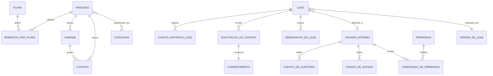

A# Modelo de domínio

**Etapa:** 05 — Modelo de domínio  
**Estado:** Aprovada  
**Referências:** [Visão geral](overview.md) · [Requisitos](requirements.md) · [Regras de negócio](business-rules.md) · [Casos de uso](use-cases.md)

Este documento descreve conceitos e relações do negócio. Não define banco de dados, ORM, classes ou serviços.

## Contextos conceituais

### Catálogo de parceiros

Responsável pelos planos, categorias, parceiros, unidades e condições exibidas publicamente.

### Operação comercial

Responsável pela captação, atribuição e acompanhamento de leads, incluindo consentimentos e histórico.

### Identidade e acesso

Responsável pelas contas internas, credenciais e permissões individuais.

### Auditoria administrativa

Responsável pela rastreabilidade imutável das alterações em usuários, permissões e operações sensíveis.

Esses contextos representam separação de responsabilidades, não aplicações ou serviços independentes.

## Catálogo de parceiros

### Plano

Representa uma modalidade do Clube Flex escolhida pelo visitante.

**Dados principais**

- nome único normalizado;
- identificador público único e estável;
- estado ativo ou inativo.

**Responsabilidades e invariantes**

- Um plano inativo não aparece no seletor público.
- Sua desativação preserva benefícios e cupons associados.
- Pode ser reativado.
- Alterar o nome não altera automaticamente seu identificador público.

### Categoria

Classifica parceiros e alimenta o único filtro do catálogo público.

**Dados principais**

- nome único normalizado;
- estado ativo ou inativo.

**Responsabilidades e invariantes**

- Pode estar associada a vários parceiros.
- Uma categoria inativa não aparece publicamente nem nas seleções ativas.
- Suas associações são preservadas durante a inatividade.

### Parceiro

Representa a organização ou profissional que oferece um benefício aos assinantes.

**Dados principais**

- nome;
- descrição;
- instruções de utilização;
- site opcional;
- identificador público único e estável;
- indicador de destaque;
- cupom geral opcional;
- estado: rascunho, publicado ou desativado.

**Relações**

- possui vários contatos;
- pertence a uma ou mais categorias;
- pode possuir várias unidades;
- possui condições para zero ou mais planos.

**Responsabilidades e invariantes**

- Nomes iguais são permitidos, com alerta administrativo de possível duplicidade.
- Um parceiro pode operar sem unidade física.
- Para ser publicado, precisa satisfazer todas as condições de `RN-001`.
- Somente aparece publicamente quando satisfaz `RN-003`.
- Alterações válidas em parceiro publicado aparecem imediatamente no catálogo.
- Alterar o nome não altera automaticamente o identificador público; identificadores anteriores são preservados para redirecionamento permanente.

### Contato

Representa um meio de contato de um parceiro ou unidade.

**Dados principais**

- tipo: telefone ou WhatsApp;
- valor normalizado;
- identificação opcional, como “Recepção” ou “WhatsApp comercial”.

**Responsabilidades e invariantes**

- O número deve possuir código do país e DDD válidos.
- Parceiros e unidades podem possuir vários contatos de cada tipo.
- Quando uma unidade não possui determinado tipo, utiliza os contatos gerais correspondentes do parceiro para exibição.

### Unidade

Representa um local físico de atendimento de um parceiro.

**Dados principais**

- identificação ou nome;
- CEP;
- logradouro;
- número ou indicação `s/n`;
- complemento opcional;
- bairro;
- cidade;
- estado, limitado inicialmente ao Rio de Janeiro;
- horário opcional em texto livre;
- instruções específicas opcionais;
- estado ativo ou inativo.

**Relações**

- pertence exatamente a um parceiro;
- pode possuir vários contatos próprios.

### Benefício por Plano

Representa a condição oferecida por um parceiro para um plano.

**Dados principais**

- percentual inteiro entre 1 e 100;
- cupom específico opcional.

**Relações e invariantes**

- Relaciona exatamente um parceiro a exatamente um plano.
- Existe no máximo um benefício para cada combinação de parceiro e plano.
- O cupom específico prevalece sobre o cupom geral do parceiro.
- Não possui vigência automática nesta entrega.

## Operação comercial

### Lead

Representa uma pessoa interessada em assinar o Clube Flex.

**Dados principais**

- nome;
- WhatsApp normalizado e único entre leads não anonimizados;
- e-mail opcional;
- etapa fixa do pipeline;
- motivo de perda opcional;
- detalhe da origem;
- indicação de existência de novo interesse pendente, derivada das solicitações não tratadas.

**Etapas fixas**

`novo → primeiro contato → em negociação → convertido → perdido`

As transições são livres. Leads convertidos ou perdidos podem ser reabertos manualmente para uma etapa escolhida.

**Relações**

- possui exatamente uma origem;
- possui zero ou um responsável;
- possui várias observações;
- possui várias solicitações de contato;
- possui vários eventos de histórico.

### Origem de Lead

Representa o canal de aquisição do lead.

**Dados principais**

- nome único normalizado;
- estado ativo ou inativo;
- indicação de origem protegida pelo sistema.

**Responsabilidades e invariantes**

- Uma origem utilizada não pode ser excluída.
- A origem automática `catálogo/site` não pode ser renomeada nem excluída.
- Origens como abordagem, indicação e campanha podem ser administradas no dashboard.

### Solicitação de Contato

Representa cada envio do formulário público, inclusive envios repetidos para o mesmo WhatsApp.

**Dados principais**

- nome informado naquele envio;
- WhatsApp normalizado;
- e-mail informado opcionalmente naquele envio;
- data e horário;
- origem do envio;
- data de tratamento opcional;
- usuário que realizou o tratamento, quando aplicável.

**Relações e invariantes**

- pertence exatamente a um lead;
- possui exatamente uma evidência de consentimento;
- a primeira solicitação cria o lead;
- solicitações posteriores não sobrescrevem os dados principais do lead;
- uma solicitação posterior não tratada representa um novo interesse pendente;
- tratar a solicitação não altera automaticamente a etapa do lead.

### Consentimento

Representa a evidência de autorização para contato comercial fornecida em uma solicitação.

**Dados principais**

- data e horário;
- texto ou versão aceita;
- origem do envio.

O endereço IP não integra a evidência nesta entrega.

### Observação do Lead

Representa um registro textual de acompanhamento.

**Dados principais**

- conteúdo;
- autor;
- data e horário de criação.

Somente o autor pode corrigi-la. A correção preserva o conteúdo anterior no histórico.

### Evento do Histórico do Lead

Registra alterações relevantes realizadas no lead.

**Conteúdo mínimo**

- tipo do evento;
- autor;
- data e horário;
- valores anterior e novo, quando aplicáveis.

**Eventos rastreados**

- criação;
- mudança de etapa;
- troca de responsável;
- alteração de contato;
- alteração de origem;
- criação ou correção de observação;
- nova solicitação pública;
- tratamento de novo interesse.

## Identidade e acesso

### Usuário Interno

Representa uma pessoa que pode acessar o dashboard.

**Dados principais**

- nome completo;
- nome de usuário único;
- e-mail opcional;
- estado ativo ou inativo;
- situação da ativação do acesso.

**Responsabilidades e invariantes**

- Uma conta nova inicia ativa, ainda não ativada e sem permissões.
- O nome de usuário é gerado conforme `RN-019` e pode ser alterado por usuário autorizado.
- Uma conta inativa não pode autenticar-se.
- Uma conta desativada permanece associada a históricos e leads anteriores.
- O último usuário ativo capaz de administrar usuários e permissões não pode ser desativado.

### Permissão

Representa uma capacidade implementada pelo sistema, pertencente ao catálogo aprovado em `RF-016`.

Permissões não são criadas livremente no dashboard e não formam papéis fixos.

### Concessão de Permissão

Representa a habilitação de uma permissão para um usuário específico.

**Invariantes**

- A conta nova não possui concessões.
- Alterações produzem efeito imediato.
- Um usuário não altera as próprias concessões.
- Um usuário não concede permissão que ele próprio não possui.

### Código de Acesso

Representa um código de uso único para ativação ou recuperação de conta.

**Dados conceituais**

- finalidade: ativação ou recuperação;
- situação: disponível, utilizado, expirado ou invalidado;
- vínculo com a conta;
- validade de 30 minutos e limite máximo de cinco tentativas, conforme a decisão de segurança aprovada.

Emitir um novo código invalida os códigos anteriores da mesma finalidade.

## Auditoria administrativa

### Evento de Auditoria

Registra operações administrativas sensíveis de forma imutável.

**Dados principais**

- tipo da ação;
- autor;
- usuário afetado, quando aplicável;
- data e horário;
- valores anterior e novo;
- referência ao objeto afetado quando necessário.

**Operações cobertas**

- criação e alteração de usuários;
- ativação e desativação de contas;
- redefinição de acesso;
- concessão e revogação de permissões;
- exclusão ou anonimização de leads.

Os eventos são preservados durante toda a vida do sistema e não podem ser editados ou removidos.

## Exclusão, desativação e anonimização

- Registros nunca utilizados podem ser excluídos quando a regra específica permitir.
- Registros com associações ou histórico devem ser desativados.
- Um lead sem histórico ou dependências pode ser excluído após revogação validada.
- Um lead com histórico operacional deve ter seus dados pessoais anonimizados.
- Após exclusão ou anonimização, um novo consentimento pode originar outro lead.

## Diagrama conceitual

## Questões encaminhadas

- Método de persistência e representação técnica das relações.
- Prazo, formato, armazenamento e entrega segura dos códigos de acesso.
- Estratégia técnica para anonimização e preservação referencial.
- Estrutura de índices, busca e normalização na persistência.
- Limites entre aplicações e módulos, a serem definidos nas etapas 06 e 07.
